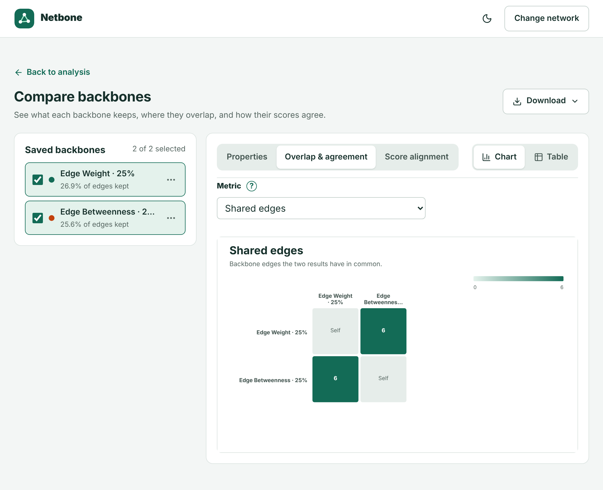
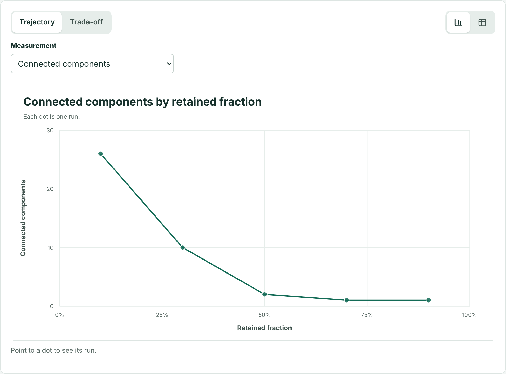

# Compare, sweep, and export in the browser

## Compare saved backbones

1. In the analysis view, filter a scored network and select **Save this
   backbone**.
2. Change the method or filter settings and save a second result. To follow
   the [browser tutorial](first-session.md), use two distinct retained
   fractions, such as 25% and 75%.
3. Select **Compare** in the bar at the bottom of the analysis. The
   comparison runs as soon as the page opens. Tick or untick saved backbones
   to change it.
4. Inspect single-result measures, pairwise overlap or score alignment.
   When values are unavailable, read the explanation in the result view.
5. Open **Download** to save the current data as CSV, the chart as SVG or
   PNG, or the comparison as a full experiment ZIP.

<figure class="docs-screenshot" markdown>

[{ loading=lazy }](../assets/screens/app-compare.png){ .docs-shot-link title="Open the full-size screenshot" }

<figcaption markdown="span">Edge Weight and Edge Betweenness backbones of Zachary’s Karate Club, both at a retained fraction of 25%, share 6 links.</figcaption>
</figure>

Overlap and ranking answer different questions. Two runs with identical
scores and different cutoffs can agree on the ranks and still choose
different edges. See [reading comparison tables](../python/compare.md).

## Explore settings with a sweep

Select **Sweep** in the bar at the bottom of the analysis. A new sweep uses
the current method and filter and already varies the main filter setting. With
**Keep a fraction**, for example, it varies **Retained fraction** from 10% to
90% in steps of 20%. Change the range under **What to vary?**, or switch to
**List** and type the values, such as `25%, 75%`.

**Add another setting** varies a second setting, and the sweep runs every
combination. **Add another setup** adds a different method or filter to the
same sweep. The browser allows at most 100 runs in a sweep.

Choose **Run sweep**. In **Sweep results**, choose a measurement, switch
between the chart and the table, and read the explanations for failed or
unavailable values. **Run settings** lists the settings of every run.
**Download** saves the measurements and runs as CSV, the settings as JSON,
the chart, or the full experiment ZIP.

<figure class="docs-screenshot" markdown>

[{ loading=lazy }](../assets/screens/app-sweep.png){ .docs-shot-link title="Open the full-size screenshot" }

<figcaption markdown="span">A sweep of the retained fraction for Edge Betweenness. The number of connected components rises quickly below 30%.</figcaption>
</figure>

## Choose what to download

| Need | Download |
| --- | --- |
| Inspect an extracted graph | GraphML or GEXF for the backbone, or for the full network with scores |
| Rerun scoring and filtering | Settings JSON plus the original input and its loading choices |
| Analyze a comparison or sweep offline | CSV for the measurements or a full experiment ZIP |
| Keep a record of an analysis | The full experiment ZIP, containing a manifest, deterministic Markdown and JSON reports, settings and tables, with graph exports for an extraction |

The preview and on-screen statistics may show a subset for larger networks.
Use the exported tables and graphs when you need all rows. The
[reproducibility guide](../python/reproduce.md) describes the bundle structure.
