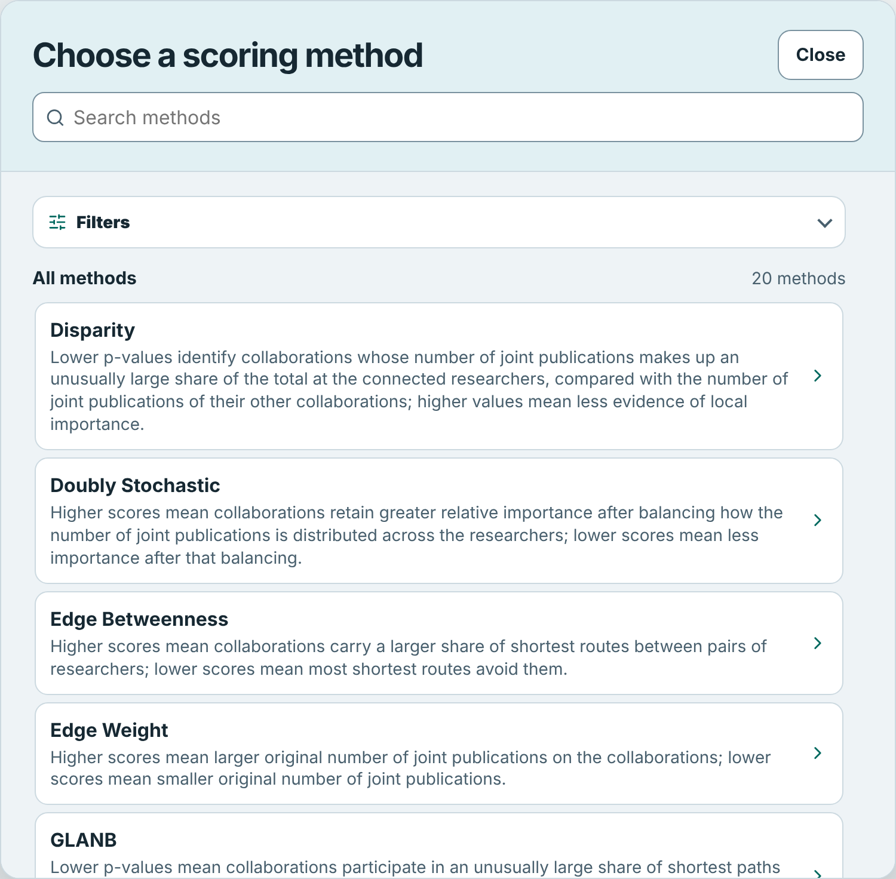
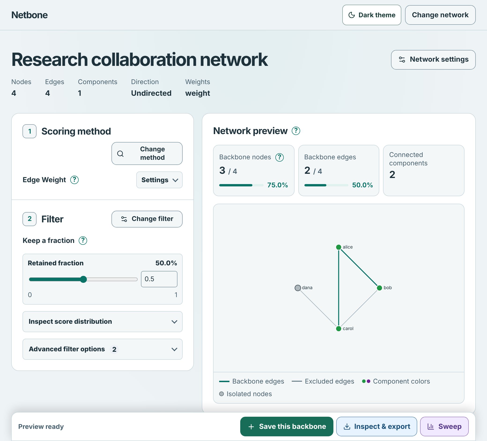
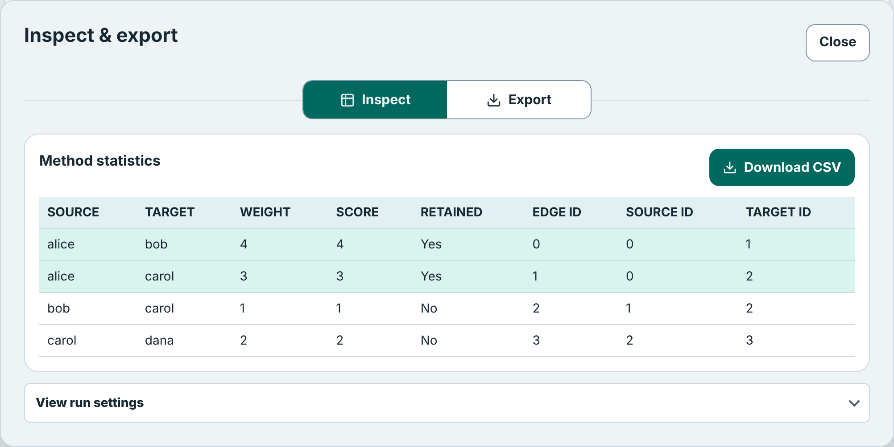

# Extract a backbone in the browser

[Try the web demo](sample-demo.md) to compare two methods on a real network
before installing the local app.

[Start the app](launch.md), then use the built-in collaboration network to
try extraction and export without preparing a file.

1. Open **Try an example** and choose **Weighted relationships**. This example
   has four links with weights 4, 3, 2, and 1.
2. If **Review network settings** opens, confirm that `source` and `target`
   are the endpoints and `weight` contains connection strengths. Choose
   **Use this mapping**.
3. Select **Choose method** if the method picker is closed, then choose
   **Edge Weight**. If **Compute scores** is available, select it to
   finish scoring.

    [{ .docs-shot loading=lazy }](../assets/screens/app-choose-method.png){ .docs-shot-link title="Open the full-size screenshot" }

4. In **Choose a filter**, select **Keep a fraction**. Set **Retained
   fraction** to 0.5. With these distinct weights, the two strongest links
   are retained.
5. Check **Network preview**. Teal edges belong to the backbone and gray edges
   were left out. **Backbone edges** counts retained links. Node coverage
   counts nodes incident to those links, which can differ from the number of
   output nodes when the result retains isolates.

    [{ .docs-shot loading=lazy }](../assets/screens/app-backbone-preview.png){ .docs-shot-link title="Open the full-size screenshot" }

6. Open **Inspect & export**. In **Inspect**, review the method statistics
   and open **View run settings** to download the pipeline JSON.

    [{ .docs-shot loading=lazy }](../assets/screens/app-inspect.png){ .docs-shot-link title="Open the full-size screenshot" }

7. Switch to **Export** for a GraphML or GEXF download. **Backbone only** is
   selected by default. Choose **Download ZIP** for the full experiment.

Use **Copy BibTeX** in the app footer to copy the Netbone citation.

Use **Save this backbone** to add the result to the current comparison list.
To see how retention sensitivity affects the result, continue with
[comparison and sweep](evaluate.md).
