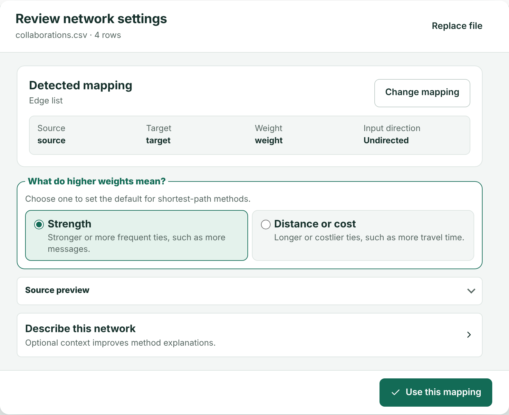

# Import a network in the browser

Select **Open a network** or drag a file onto that button. Review the
detected settings and the rows or graph summary before accepting the mapping.
You can reopen the settings from the network summary.

<figure class="docs-screenshot" markdown>

[{ loading=lazy }](../assets/screens/app-network-settings.png){ .docs-shot-link title="Open the full-size screenshot" }

<figcaption markdown="span">The detected mapping for a weighted edge list. Choose what higher weights mean, then use the mapping.</figcaption>
</figure>

| Input format | Settings to verify |
| --- | --- |
| CSV, TSV, or space-separated edge list | Delimiter, source and target columns, optional weight, and direction. A static edge list represents one row per edge or arc. |
| CSV, TSV, or space-separated temporal event list | Select **Temporal event list** and map time and optional event magnitude as well as the endpoints. Choose a weighting and its timing parameters. |
| GraphML | Confirm graph direction and choose a numeric edge attribute if the analysis uses weights. |

Every edge or event list needs a header row that names its columns. The app
detects a comma, semicolon, tab, or space delimiter from that row. If the
columns look wrong, change **Delimiter** in the settings. With **Space**, any
run of spaces or tabs separates two values.

Repeated static rows for the same edge are duplicates. Use a temporal event
list if each row is a distinct time-stamped event. If a file carries weights,
choose the appropriate numeric column and indicate whether larger values
represent **Strength** or **Distance**. This choice guides path-based method
settings. It does not change the imported values.

## Analyze directed inputs

Declare source-to-target direction for directed edge and event lists. GraphML
provides direction in the file. Keep orientation for a method that supports
directed graphs. If you need an undirected method, the settings offer a
projection. Choose how to merge weighted reciprocal arcs using sum, mean,
maximum, or minimum. Use the [method catalog](../reference/methods.md) to
check direction and weight requirements.

## Aggregate events before scoring

Select the temporal weighting, set the evaluation time when needed, and
review the resulting static network. Repeated events aggregate per pair or per
ordered arc. Check the [temporal aggregation guide](../python/temporal.md)
for snapshot size, elapsed-time units and magnitude rules.

A method may be unavailable for the loaded graph or its selected attribute.
Read the compatibility message under the method and correct the settings or
choose a compatible method. The [troubleshooting guide](../help.md) covers
common failures.
