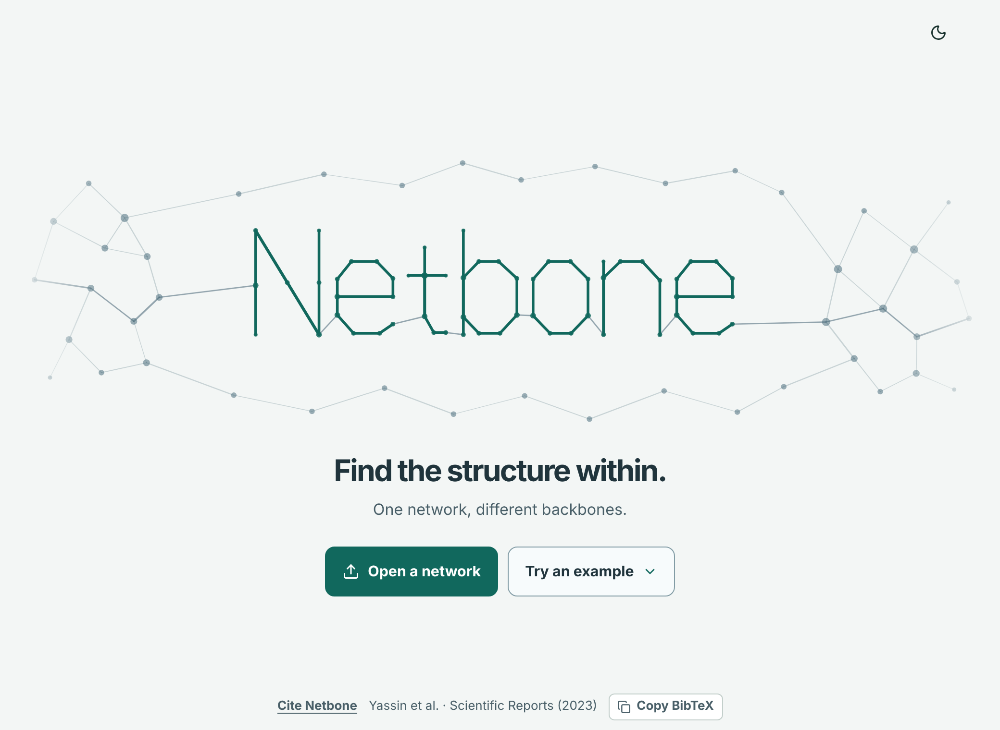

# Run the local web app

Install Netbone in your [Python environment](../start/install.md), then start
the app with the same Python.

```bash
python -m netbone.webapp
```

This command works on every system, because it runs the app through the
Python that has Netbone installed. The install also adds a shorter
`netbone-web` command. It works only when Python's scripts folder is on your
`PATH`, as it is in an activated virtual environment. If your shell reports
that `netbone-web` is not found, keep using `python -m netbone.webapp`.

Open [127.0.0.1:8765](http://127.0.0.1:8765/) in a browser on the same machine.
Keep the terminal open while you work. Press Ctrl+C there to stop the server.
The installed distribution includes the browser assets. A separate frontend
build is only needed when developing the UI.

<figure class="docs-screenshot" markdown>

[{ loading=lazy }](../assets/screens/app-start.png){ .docs-shot-link title="Open the full-size screenshot" }

<figcaption markdown="span">The start screen. Open your own file or try one of the built-in examples.</figcaption>
</figure>

## Startup options

`python -m netbone.webapp --help` lists the startup settings.

| Option | Default | Purpose |
| --- | --- | --- |
| `--host` | `127.0.0.1` | Address where the local server listens |
| `--port` | `8765` | TCP port |
| `--max-upload-mb` | `100` | Largest file the app accepts, in megabytes |

If the default port is occupied, choose another local port.

```bash
python -m netbone.webapp --port 8766
```

Then open [127.0.0.1:8766](http://127.0.0.1:8766/).

A larger upload is refused with a message naming the limit. Raise it with, for
example, `python -m netbone.webapp --max-upload-mb 500`.

## Where data is processed

The browser sends the network to the local Python process for analysis. The
server keeps recent scores, results and export handles in memory. Download
files you want to retain before leaving the session. Restarting the server
clears its caches.

The supported setup is loopback on your own machine. The bundled server has
no authentication or TLS and there is no supported hosted deployment. The app
uses local HTTP routes for previews, analyses, and downloads. Their request
formats and cached IDs belong to the browser implementation. Use the
[Python API](../reference/pipelines.md) for scripted analysis.

Continue with the [browser tutorial](first-session.md) or
[import your own network](import.md).
