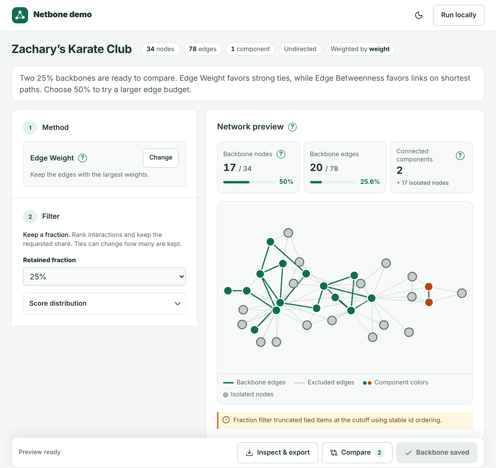

# Try the web demo

Explore Zachary’s Karate Club, a real network of 34 members and 78 links.
Edge weights count the contexts in which two members interacted.

<a href="../../demo/" class="docs-button">Open the web demo</a>

<figure class="docs-screenshot" markdown>

[{ loading=lazy }](../assets/screens/demo-workbench.png){ .docs-shot-link title="Open the full-size screenshot" }

<figcaption markdown="span">The demo runs the same workbench as the local app, with precomputed results.</figcaption>
</figure>

## Compare two 20-edge backbones

The demo opens with Edge Weight at 25% retention and two saved backbones at
this edge budget.

1. Select **Compare** in the bar at the bottom, then **Overlap & agreement**,
   and choose **Shared edges** as the metric.
2. Check the 6 shared links. Each method kept 20 links, with 14 selections
   unique to each method.
3. Select **Back to analysis**. Choose **Change** beside the method to see
   how weighted Edge Betweenness brings a different set of links into the
   graph.
4. Choose **50%** to see what changes when the edge budget grows.

Edge Weight ranks ties by their observed strength. Edge Betweenness ranks
them by how often they lie on shortest paths, treating higher weights as
shorter distances. Both use a stable tie rule to keep the same number of links.

The demo loads precomputed Netbone results, including the statistics and
downloads, for this dataset and its available settings. Use the
[local web app](launch.md) to import your own file.

Open **Inspect & export** to explore the method statistics and run settings.
Its **Download** menu saves the graph, the settings or the experiment ZIP. Use **Copy BibTeX** in the
footer to copy the Netbone citation.

[Karate Club dataset](https://networkx.org/documentation/stable/reference/generated/networkx.generators.social.karate_club_graph.html)
